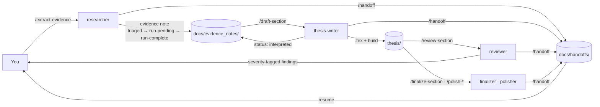

# Agentic thesis writing

Research agents and writing agents for a LaTeX thesis, kept apart by a hard boundary and
connected by **handoff notes**. The research side runs the analyses and writes down what it
found. The writing side turns that into chapters and never invents a number. The TeX lives
in the repository, the agents compile it, and a set of TU Delft writing rules keeps the
prose in shape. When the thesis is done, the same notes feed a defence talk, with
animations from [manim-hep](https://github.com/NielsterLinden/manim-hep).

This repository was distilled from the workflow of an MSc thesis in experimental particle
physics, written with coding-agent subagents over several months. Everything specific to
that project has been removed; what is left is the structure that made it work.

## The loop



| Step | Command | Agent | Writes | Reads |
|---|---|---|---|---|
| 1 | `/extract-evidence ch4.2 tokenizer` | `researcher` | code, configs, `docs/evidence_notes/` | everything |
| 2 | `/draft-section ch4.2 tokenizer` | `thesis-writer` | `thesis/` | the evidence note, the chapter |
| 3 | `/review-section thesis/mainmatter/04_*.tex` | `reviewer` | nothing | the section, the notes |
| 4 | `/finalize-section ch4.2` | `thesis-finalizer` | a staged critique and rewrite; the chapter only on a literal `apply` | the chapter, figures, the PDF |
| 5 | `/polish-write`, `/polish-plot`, `/polish-global` | `thesis-polisher` | small, reviewable edits | the whole chapter |
| any | `/handoff <slug>` | whoever is working | `docs/handoffs/` | the current state |
| any | `/check-writing <path>` | `writing-rules-checker` | nothing | `.tex` files |
| later | `/deck-storyline` | `deck-planner` | `presentation/STORYLINE.md`, clip briefs | the chapters |

Three rules make the loop safe:

1. **Disjoint write scopes.** The researcher never edits `thesis/`; the writer never edits
   code, configs or data. The reviewer edits nothing.
2. **One channel between them.** An evidence note per thesis section, with a status that
   only moves forward. The writer may not draft results prose from a note below
   `run-complete`, and may not state a number that is not in a note.
3. **Additive artefacts.** Figures enter the TeX tree only through `figure-import`, into a
   timestamped directory, with the source path written back into the note. Nothing under
   `thesis/figures/` is ever overwritten.

## Quick install (with an agent)

Open your coding agent in the repository that holds (or will hold) your thesis and paste:

> Set up agentic-thesis-writing in this repository: follow https://github.com/NielsterLinden/agentic-thesis-writing/blob/main/docs/install/AGENT_INSTALL.md and ask me the setup questions first.

The agent asks a few questions, runs the installer, builds the thesis template once, and
reports what it did. It never overwrites your files and never pushes. See
[QUICKINSTALL.md](QUICKINSTALL.md).

**Claude Code users** can also load the agents, skills and commands as a plugin:

```
/plugin marketplace add NielsterLinden/agentic-thesis-writing
/plugin install agentic-thesis-writing@agentic-thesis-writing
```

and then scaffold the project files with `python3 scripts/atw.py install --agent claude-plugin`.

**By hand:** [docs/install/HUMAN_GUIDE.md](docs/install/HUMAN_GUIDE.md).

## What is inside

| | |
|---|---|
| **Agents** (`plugin/agents/`) | `researcher`, `thesis-writer`, `reviewer`, `thesis-finalizer`, `thesis-polisher`, `writing-rules-checker`, `deck-planner` |
| **Skills** (`plugin/skills/`) | `evidence-note`, `handoff-note`, `figure-import`, `data-inventory`, `trace-claim`, `latex-build`, `tudelft-writing-rules`, `thesis-to-deck`, `thesis-setup` |
| **Commands** (`plugin/commands/`) | `/extract-evidence`, `/draft-section`, `/review-section`, `/finalize-section`, `/polish-global`, `/polish-write`, `/polish-plot`, `/build-thesis`, `/handoff`, `/check-writing`, `/deck-storyline` |
| **Templates** (`templates/`) | the TU Delft LaTeX thesis (XeLaTeX + biber, `latexmk`), the project `AGENTS.md` contract, evidence-note and handoff-note folders, a presentation folder |
| **Tools** (`scripts/`, skill folders) | `atw.py` (installer and note generators), `check_writing_rules.py` (a `.tex` linter for the writing rules), `figure_import.py` |
| **Docs** (`docs/`) | [WORKFLOW](docs/WORKFLOW.md) · [HANDOFF_NOTES](docs/HANDOFF_NOTES.md) · [WRITING_RULES](docs/WRITING_RULES.md) · [LATEX](docs/LATEX.md) · [PLOTTING_STYLE](docs/PLOTTING_STYLE.md) · [PRESENTATION](docs/PRESENTATION.md) · [ADAPTING](docs/ADAPTING.md) |

## Handoff notes

Four kinds of note carry work across the boundary. Each has a template and a skill.

| Note | From → to | Lives in | Key field |
|---|---|---|---|
| **Evidence note** | researcher → writer | `docs/evidence_notes/<chN.S>_<slug>.md` | `Status:` state machine; `Thesis-safe interpretation` paragraph the writer may lift |
| **Task handoff** | anyone → anyone (or your future self) | `docs/handoffs/<date>_<slug>.md` | "How to resume" matrix; copy-paste agent invocations; user checkpoints |
| **Critique + proposed rewrite** | finalizer → you | `docs/finalizer/<chN.S>/<timestamp>/` | `[SEVERITY/ACTION]` entries; applied only on the literal word `apply` |
| **Review** | reviewer → writer | chat (or a file you ask for) | `[BLOCK] [MAJOR] [MINOR] [NOTE]`, a cuts block, a six-axis grade |

[docs/HANDOFF_NOTES.md](docs/HANDOFF_NOTES.md) explains why the notes are shaped this way
and shows a worked example ([examples/worked-example/](examples/worked-example/)).

## TeX inside the repository

`templates/thesis/` is the [unofficial TU Delft report/thesis template](https://github.com/dzwaneveld/tudelft-report-thesis-template)
by Daan Zwaneveld (CC BY-NC 4.0), with three small changes: the house-style fonts fall back
to free fonts when Arial or Roboto Slab are missing, the logo and cover image are optional,
and a `\todo{}` macro marks pending values. The agents build it with
`latexmk -pdfxe report.tex` (the `.latexmkrc` selects XeLaTeX and biber) and read
`report.log` on failure. A GitHub Actions workflow compiles the template on every change to
it. See [docs/LATEX.md](docs/LATEX.md).

## Writing rules

[docs/WRITING_RULES.md](docs/WRITING_RULES.md) is a condensed set of academic-writing
conventions in the TU Delft tradition: short sentences, active voice with impersonal
subjects, hedged claims, linking words used on purpose, no contractions, no sentence-initial
FANBOYS, no phrasal verbs, no em or en dashes, one idea per paragraph, chapter → section →
subsection and no deeper. The `thesis-writer` follows them, the `reviewer` grades against
them, and `check_writing_rules.py` catches the mechanical ones:

```bash
python3 plugin/skills/tudelft-writing-rules/check_writing_rules.py thesis/mainmatter/
```

Check the current guidelines of your own faculty; the rules file is meant to be edited.

## Presentations

A defence talk follows the thesis, so the same evidence notes feed the slides. The
`deck-planner` agent turns chapters into a three-act storyline and per-clip briefs, keeps a
`PATHS.md` manifest of which figure and which number came from where, and hands the
animation work to [manim-hep](https://github.com/NielsterLinden/manim-hep), whose agents
(`scene-builder`, `plot-recreator`, `render-verifier`, `physics-checker`) build and check the
clips. The house rule carried over from the thesis: clips are animation only; narrative text
is added in the slide tool, where you control wording and font. See
[docs/PRESENTATION.md](docs/PRESENTATION.md).

## Adapting it to your project

Everything project-specific lives in one place: the **Project map** section of the
`AGENTS.md` that the installer writes into your repository (thesis directory, research
directories, data root, canonical results table, how long jobs are submitted, optional
identifier registry). The agents read it first. [docs/ADAPTING.md](docs/ADAPTING.md) covers
other LaTeX templates, other writing rules, other agent tools (Codex, Cursor) and how to
trim the set of agents.

## Works with

- **Claude Code:** agents, skills and slash commands, as a plugin or copied into `.claude/`.
- **Codex, Cursor and others:** the `AGENTS.md` contract and the skills folder
  (`.agents/skills/`). The slash commands become prompts you paste; every command file is
  written so that works.
- **No agent at all:** the handoff-note workflow, the LaTeX template and the linter are
  useful on their own.

## Origin and credits

The agent definitions, skills and notes grew out of one thesis project and were cleaned up
for reuse. The LaTeX template is by [Daan Zwaneveld](https://dzwaneveld.github.io)
(CC BY-NC 4.0; see [templates/thesis/LICENSE-TEMPLATE.md](templates/thesis/LICENSE-TEMPLATE.md)).
The four working principles in `AGENTS.md` are adapted from
[andrej-karpathy-skills](https://github.com/multica-ai/andrej-karpathy-skills). The
animation side builds on [manim-hep](https://github.com/NielsterLinden/manim-hep) and thereby
on Manim Community Edition.

Not affiliated with or endorsed by TU Delft. The writing rules are a personal condensation;
your faculty's guidelines take precedence.

## License

MIT for everything in this repository except `templates/thesis/`, which keeps the
template's CC BY-NC 4.0 licence. See [LICENSE](LICENSE).
